# Move posters: content sheet

*Gathered 2026-10-13 from the code at `main` (`7d1485f`), the site run locally from that code, and `docs/design/`. Nothing in the app was changed. "Code" means the file and line named; "spec" means a design document; anything I couldn't find is marked "not found". Images are in `icons/` (see the list at the end).*

## Karl's decisions (2026-10-13)

1. **Trade places** is the name for the two-boxes poster. "Switch sides" stays retired.
2. **The opposite box is drawn "−□"** (a dash in front of the box), as the app already draws it in Boxes & Circles and Value it. `SPEC-FLIP-IT.md` §1 says the opposite of this ("never as 'a box with a minus'"); that line needs changing in the design chat.
3. **On the posters, the x box is empty and the counters are black on white.** Use `pieces/x-box-boxes-and-circles.png`, `pieces/positive-counter.png` and `pieces/negative-counter.png`. (The app itself still draws an "x" inside the box in Solve it scaffolds, and green/magenta counters in the group diagram; that is an app question for later, not changed here.)
4. **Moves with no equation picture use the Count it / Build it pictures as references:** see Flip everything, Multiply and Trade places in §4.
5. **The goal is the light's own words**, from the Why? column. The Why? column is likely to be renamed **"Goals"**.
6. **For print, use real Lexend 700 or 800**, not the browser's faked bold.

## 1. Summary

| Move (name students see) | Icon | Lights it works toward | Goal (the light's words) | Built? |
|---|---|---|---|---|
| Add ___ to both sides | 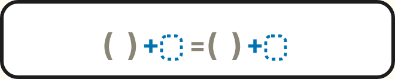 | Fewer terms | **Fewer terms** | Built (Add to both sides, L1-L6) |
| Cross the border | 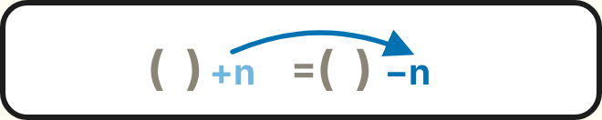 | Fewer terms | **Fewer terms** | Designed only (greyed everywhere). An older retired card, "Switch sides", did this move. |
| Take a fraction of both sides | 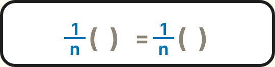 | Smaller numbers, One box (No fractions: unclear) | **One box** | Built (Divide it, L1-L6) |
| Multiply both sides by ___ | 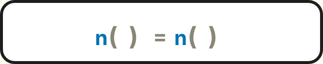 | No fractions, Smaller numbers, One box (code layout only) | **No fractions** | Designed only (no card spec) |
| Flip everything | 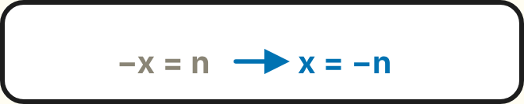 | No opposite box | **No opposite box** | Designed (`SPEC-FLIP-IT.md` rev 1.0), not built |
| Trade places | 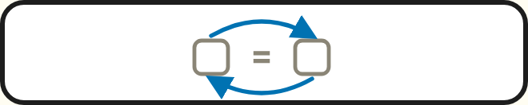 | x on the left | **x on the left** | Built on Add to both sides L5 (only when x is on the right) |
| Distribute | 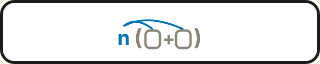 | Each side simplified | **Each side simplified** | Designed only as a Solve it move. Built as Build it cards. |
| Combine like terms | 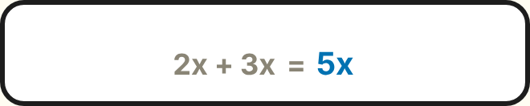 | Each side simplified | **Each side simplified** | Designed only as a Solve it move. Built as Build it cards. |
| *(the big goal, last row of the panel)* | 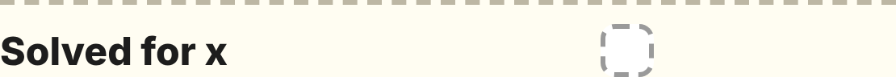 | Solved for x | **Solved for x** | Built |

## 2. Step 1: the moves, in panel order

**Confirmed from the code:** `src/view/lightScreen.js:17-26` (the `MOVES` list, "same on every card of the unit"). Top to bottom:

1. `add`: Add ___ to both sides
2. `cross`: Cross the border
3. `fraction`: Take a fraction of both sides
4. `multiply`: Multiply both sides by ___
5. `flip`: Flip everything
6. `trade`: Trade places
7. `distribute`: Distribute
8. `combine`: Combine like terms

The loop spec gives the same order (`SPEC-SOLVE-IT-LOOP.md` §5).

**Live or greyed, by card (code):**
- **Add to both sides:** only `add` is live. `trade` is also live **on Level 5, when x is on the right, on the move path** (`lightScreen.js:274-276`; `addBothMoves.js` `tradeAvailable`). Every other move is greyed.
- **Divide it:** only `fraction` is live.
- `cross`, `multiply`, `flip`, `distribute` and `combine` are **greyed on every built card**. Tapping one says "That move unlocks on a later card." On Divide it, the moves from an earlier card (`add`, `cross`, `trade`) say "You don't need that move here." (`divideMoves.js` `EARLIER`).

**Actions inside a move that only appear in a scaffold (not separate moves):**
- **Add:** add to the left, add to the right, then Go (the two-action form), and the Party!/Battle! combining step.
- **Divide it:** dealing counters into groups, Deal a round (Level 4 and up), and keeping a group.
- **Both Level 1s:** "Take ⅓ of the left / of the right".

## 3. Lights × moves

The panel's Why? boxes, with exact labels from `lightScreen.js:253-259` (the `WHYS` list). Each group of boxes is drawn beside the moves in the rows named.

| Light (exact label) | add | cross | fraction | multiply | flip | trade | distribute | combine | Source |
|---|---|---|---|---|---|---|---|---|---|
| **Fewer terms** | ● | ● | | | | | | | Code: drawn beside rows 1-2. Judged on Add (`addBothMoves.js` `judge`). Spec: Add §3E (Add); Add §3A says Cross the border sits second "because it goes with the Fewer terms goal". |
| **No fractions** | ○ | | ● | ● | | | | | Code: drawn beside rows 3-4, never judged. Spec: Divide it §4 says No fractions "arrives on the Fraction equations card" (not designed yet). **Unclear.** |
| **Smaller numbers** | | | ● | ● | ○ | | | | Code: beside rows 3-4; judged on Divide it. Spec: Divide it §4. Flip it §3E pairs it with Take a fraction from L4 on. Multiply: code layout only. |
| **One box** | | | ● | ● | ○ | | | | Code: beside rows 3-4; judged on Divide it. Spec: Divide it §4; Flip it §3E (with Take a fraction). Multiply: code layout only. |
| **No opposite box** | | | | | ● | | | | Code: beside row 5. Spec: Flip it §3E; `DECISION-LOG.md` "Lights". Not judged anywhere yet. |
| **x on the left** | | | | | | ● | | | Code: beside row 6. On Add L5 it turns green with any good move rather than being judged (Add build notes §17). Spec: `DECISION-LOG.md` (`4 = x` bullet, and "Fewer terms → x alone → x on the left (L4+)"). |
| **Each side simplified** | | | | | | | ● | ● | Code: beside rows 7-8. Spec: `DECISION-LOG.md` ("Distribute + combine like terms are one cycle so the 'each side simplified' light can go green"). Not judged anywhere yet. |
| **Solved for x** | all | all | all | all | all | all | all | all | Code: the last row (`lightScreen.js:294`). Spec: loop §5 ("the uber-goal"). Flip it redefines it: x alone *with a positive coefficient*. |

● = paired by the code's panel layout, and by a spec where named. ○ = a spec pairs it, but the code's panel draws it beside other moves.

**Where sources disagree (I haven't picked one):**
- **No fractions:** the code draws it beside Take a fraction; the Divide it spec says it belongs to the (undesigned) Fraction equations card.
- **Add to both sides lights the other boxes:** on Add, the boxes other than Fewer terms turn green together with a good move (`lightScreen.js:287`, the default). The loop and Divide it specs say unjudged boxes should be faint outlines, and Divide it draws them faint.
- **Smaller numbers / One box with Flip everything:** Flip it §3E pairs them with Take a fraction, not with Flip. The code draws them beside fraction and multiply, which agrees.
- **A "Balanced" light:** the tucked layout pilot (`?layout=tucked`) shows a "Balanced" light in its Why? column (the check result). It is not a panel light in any spec.

## 4. One section per move

### 4.1 Add ___ to both sides (`add`)
- **Names:**
  - Code label and tooltip: "Add ___ to both sides" (`lightScreen.js:18`).
  - Line prompts: "Choose “Add ___ to both sides” in the move list." and "Add [ ] to both sides" (the amount blank).
  - Specs: the same. Card name: "Add to both sides".
  - Printed notes vocabulary (`DESIGN-HANDOFF.md` §2): "B · Add the same to both sides". We never say "take away from both sides".
- **Icon:**  `icons/add.png` (live button), `icons/add.svg`. Source: `lightScreen.js:47`. It reads `( ) + ▢ = ( ) + ▢`, with the + and the dotted boxes in blue.
- **Lights:** Fewer terms; then Solved for x.
- **Goal candidates:** **Fewer terms** (2 words) · Cancel the number (3) · Get x alone (3).
  - **Use: Fewer terms.** It is the light's exact wording, and it is what the box judges.
  - "Get x alone" is from the line: "To get x alone, cancel the number next to it."
- **Worked example** (`SPEC-ADD-TO-BOTH-SIDES.md` §1; ✓ checked):
  1. `x − 6 = 9`
  2. Add **6** to both sides: `x − 6 + 6 = 9 + 6`
  3. `x = 9 + 6`

  Check: x = 15, 15 − 6 = 9 ✓.
- **Picture:** 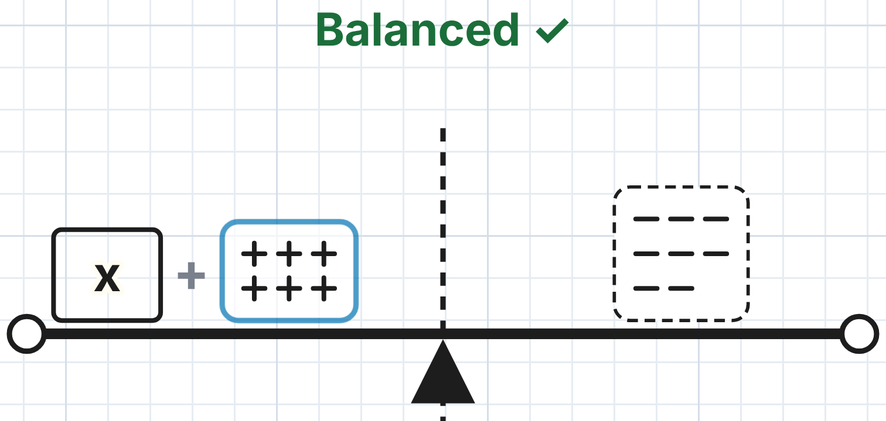
  - The seesaw from I'm stuck: the x box and a group of + counters on the left, a dashed group of − counters on the right, standing on a beam over a dashed border, with the readout "Balanced ✓".
  - Adding to one side tips the beam; adding the same to the other side levels it.
  - File: `icons/pictures/add-scaffold-seesaw.png` (Level 4, second I'm stuck).
- **First appears:** Add to both sides, Level 1 (numbers only), and as the equation move from Level 2. **Built.**

### 4.2 Cross the border (`cross`)
- **Names:**
  - Code label and tooltip: "Cross the border" (`lightScreen.js:19`).
  - Specs: "Cross the border", also called "move-and-flip" (`DECISION-LOG.md`).
  - The retired card that did this move is called **"Switch sides"** (`packs/index.js`, id `switch`). Its line says: "Switch sides: drag the +10 across the border (or tap it). When a counter crosses, it switches teams."
  - Printed notes: "A · Switch sides" (`DESIGN-HANDOFF.md` §2).
- **Icon:**  `icons/cross.png` (rebuilt from the greyed button, see §7), `icons/cross.svg`. Source: `lightScreen.js:49`. It reads `( ) +n = ( ) −n`: a light-blue +n with an arrow over the = landing as a darker −n.
- **Lights:** Fewer terms (code layout; Add spec §3A).
- **Goal candidates:** **Fewer terms** · Switch teams · Cross, switch teams.
  - **Use: Fewer terms**, the light's own wording.
  - "Switch teams" is the app's wording for what happens to the number. It is better as a caption than as the goal.
- **Worked example** (the retired Switch sides card, Level 1, as the app shows it; the record format is from `engine/switchSides.js:24`; ✓ checked):
  1. `x + 10 = 20`
  2. Drag the **+10** across the border: it becomes **−10**: `x = 20 + −10`
  3. x = 10

  Check: 10 + 10 = 20 ✓.
- **Picture:** 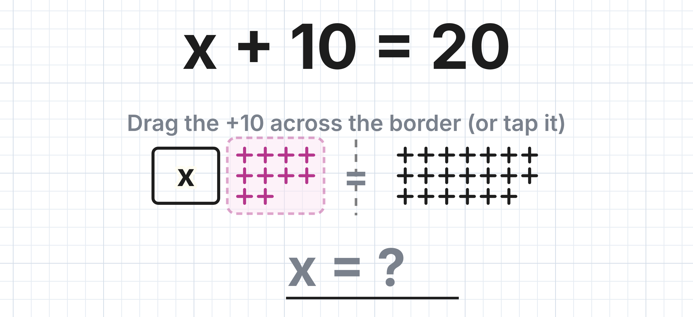
  - The x box and the +10 counters (magenta, in a dashed pink box, ready to drag) on the left; 20 counters on the right; a dashed border between them.
  - When the counters cross, they switch teams.
  - File: `icons/pictures/cross-the-border-switch-sides.png`. The card is retired: it is not on the menu, but `?pack=switch&level=1` still opens it.
- **First appears:**
  - In the new Solve it: **designed only**. `SPEC-FLIP-IT.md` §6: "taught in later levels of Add to both sides (and unlocks again on Two-step and the multi-step cards)". Those levels are not built.
  - The old Switch sides card is **built but retired**.

### 4.3 Take a fraction of both sides (`fraction`)
- **Names:**
  - Code label and tooltip: "Take a fraction of both sides" (`lightScreen.js:20`).
  - The fraction buttons read `× ⅓` over `÷ 3`, with "Take [ ] of both sides" around them (`divideScreen.js` `fractionRow`).
  - Card name: "Divide it".
  - Specs: "Take a fraction of both sides". The printed notes say "Sharing among boxes" (the spec says it is to be renamed "Divide it").
- **Icon:**  `icons/fraction.png` (live button on Divide it), `icons/fraction.svg`. Source: `lightScreen.js:50`. It reads `1/n ( ) = 1/n ( )`, with the fractions in blue.
- **Lights:** Smaller numbers, One box (judged); No fractions is drawn beside it but not judged (see §3).
- **Goal candidates:** **One box** · Smaller numbers · Leave one box.
  - **Use: One box.** It is the light's exact wording and the finishing condition. Smaller numbers is the partial-move light.
  - "Leave one box" is from the app's takeaway: "Taking a fraction of both sides can leave one box."
- **Worked example** (`SPEC-DIVIDE-IT.md` §1; ✓ checked):
  1. `3x = −12`
  2. Take **⅓** of both sides: `⅓(3x) = ⅓(−12)`
  3. `x = ⅓(−12)`

  Check: x = −4, 3 × (−4) = −12 ✓.
- **Picture:** 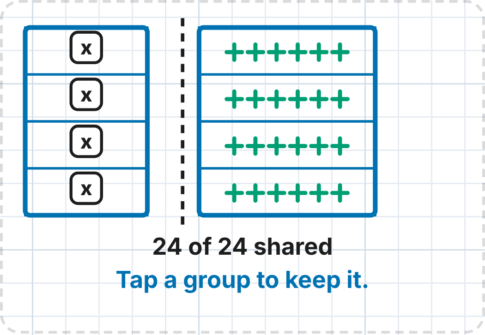 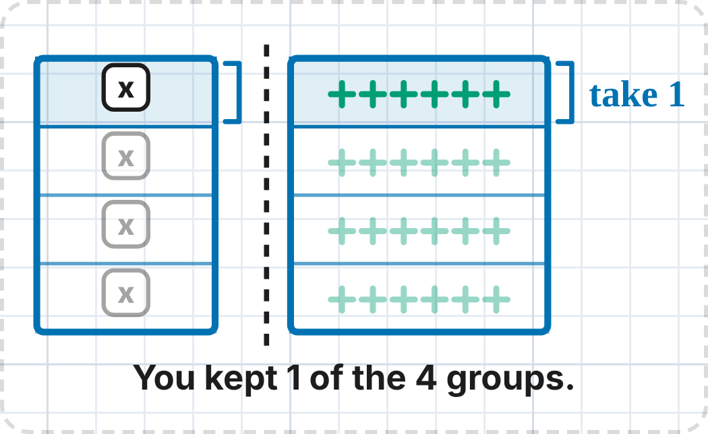
  - The counters scaffold: the boxes on the left, and the counters on the right, dealt into equal groups (one group per box), with a dashed border between.
  - The student keeps one group; a bracket labelled "take 1" marks it and the other groups fade.
  - Files: `fraction-scaffold-start.png`, `fraction-scaffold-dealt.png`, `fraction-scaffold-kept.png`.
- **First appears:** Divide it, Level 1 (numbers only), and as the equation move from Level 2. **Built.**

### 4.4 Multiply both sides by ___ (`multiply`)
- **Names:**
  - Code label and tooltip: "Multiply both sides by ___" (`lightScreen.js:21`).
  - Specs: only in the move list (loop §5, Add §3A). There is **no card spec**.
- **Icon:**  `icons/multiply.png` (rebuilt, see §7), `icons/multiply.svg`. Source: `lightScreen.js:51`. It reads `n( ) = n( )`, with the n in blue.
- **Lights:** No fractions, Smaller numbers, One box. This pairing comes **from the code's layout only**; no spec pairs a light with Multiply.
- **Goal candidates:** **No fractions** · Clear the fractions · One box.
  - **Use: No fractions**, but this is a guess from the layout. Please confirm.
- **Worked example:** **none in the move form.**
  - The app's old One-step card has `x/a = b` problems, e.g. `x/2 = 8` → 16 (from `generateSolveLevel(4, seed 1)`; ✓ 16/2 = 8). It is solved by typing the answer, not by a move.
  - If you want one, following the icon and Divide it's pattern it would be `2(x/2) = 2(8)` → `x = 2(8)`. **I constructed this; it is not in the code or the specs.**
- **Picture:** no equation picture in the app.
- **Reference picture (Build it, Value it Level 4, "fractions of x"):** 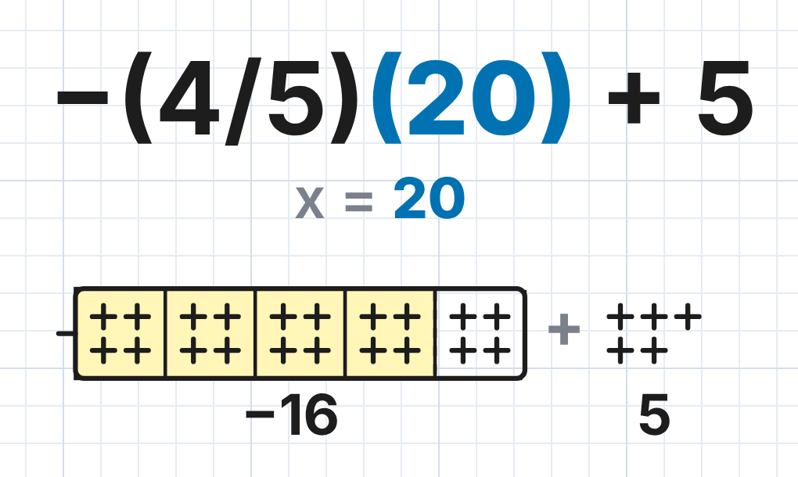
  - `−(4/5)(20) + 5` with x = 20: the box is split into 5 equal parts of 4 counters; 4 parts are taken (shaded), and the dash in front makes it the opposite box.
  - It shows a fraction of x, the thing Multiply clears. Group It's "A groups of B" pictures (under Flip everything) show multiplication as groups.
- **First appears:** designed only (greyed). The old One-step card's `x/a = b` level is built and still on the menu.

### 4.5 Flip everything (`flip`)
- **Names:**
  - Code label and tooltip: "Flip everything" (`lightScreen.js:22`).
  - Spec: "Flip everything", annotated "take the opposite of both sides". The card name is **"Flip it"**.
  - **Clash:** Count it already has a card called **"Flip It"** (subtracting integers).
- **Icon:**  `icons/flip.png` (rebuilt, see §7), `icons/flip.svg`. Source: `lightScreen.js:53`. It reads `−x = n → x = −n`, with the right half in blue.
- **Lights:** No opposite box (`SPEC-FLIP-IT.md` §3E; code layout).
- **Goal candidates:** **No opposite box** · Regular box · Make the box regular.
  - **Use: No opposite box**, the light's exact wording.
  - The spec's line is "We want a regular box."
- **Worked example** (`SPEC-FLIP-IT.md` §1; ✓ checked):
  1. `−x = 12`
  2. Flip everything: `−(−x) = −(12)`
  3. `x = −(12)`

  Check: x = −12, −(−12) = 12 ✓.
- **Picture:** no equation picture in the app. The spec describes counters turning into their opposites and boxes into opposite boxes, all at once on both sides (`SPEC-FLIP-IT.md` §1, "Picture").
- **Reference picture (Count it, Group It Level 3, "opposite of" groups):** 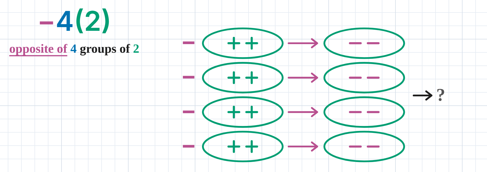
  - `−4(2)`, "opposite of 4 groups of 2": each group of ++ has a magenta − in front, and a magenta arrow turns it into a group of −−.
  - Before the flip: `icons/pictures/reference-flip-group-it-before.png`. After: `reference-flip-group-it-after.png`.
- **First appears:** Flip it, Level 2 (L1 is numeric). **Designed, not built.**

### 4.6 Trade places (`trade`)
- **Names:**
  - Code label and tooltip: "Trade places" (`lightScreen.js:23`).
  - Line prompts: "x is on the right. Click “Trade places” to rewrite the equation with x on the left." and "The same equation with the sides traded: x is on the left now."
  - Specs: "Trade places (not 'flip') swaps the two sides" (`DECISION-LOG.md`).
  - **Poster name: Trade places** (decided 2026-10-13). "Switch sides" is the old name of *Cross the border* (§4.2), so it is not used for this icon.
- **Icon:**  `icons/trade.png` (live button, Add to both sides L5), `icons/trade.svg`. Source: `lightScreen.js:55`. It shows two boxes either side of an =, with blue arrows going over the top one way and under the bottom the other.
- **Lights:** x on the left.
- **Goal candidates:** **x on the left** · x on left · Read x first.
  - **Use: x on the left**, the light's exact wording.
- **Worked example** (Add to both sides L5 sample bank, `SPEC-ADD-TO-BOTH-SIDES.md` §2; ✓ checked):
  1. `7 = x + 3`
  2. Trade places: `x + 3 = 7`
  3. The equation is unchanged; then Add −3 to both sides.

  Check: x = 4, 4 + 3 = 7 ✓.
- **Picture:** none in the app. The move rewrites the equation as a new row.
- **Reference picture:** **I found none in Count it or Build it.** No card there has two sides to swap. The nearest is Add's seesaw (§4.1) with the two sides traded; that would be a new drawing. **Question for you.**
- **First appears:**
  - Add to both sides, **Level 5**, live only when x is on the right. The first time per play it is pointed out and Add waits for it (Add build notes §17). **Built.**
  - `DECISION-LOG.md` once said "introduced in L4 with a numeric tutorial". That line was later reversed.

### 4.7 Distribute (`distribute`)
- **Names:** code label and tooltip "Distribute" (`lightScreen.js:24`). The Build it cards are called "Groups of Terms" and "Distribute, then combine". The printed notes say "Open the groups first!" (`SPEC-ROADMAP.md`).
- **Icon:**  `icons/distribute.png` (rebuilt, see §7), `icons/distribute.svg`. Source: `lightScreen.js:56`. It reads `n(▢ + ▢)`, with blue arrows from the n to each box.
- **Lights:** Each side simplified (`DECISION-LOG.md`; code layout).
- **Goal candidates:** **Each side simplified** (3 words) · Open the groups (3) · Simplify each side (3).
  - **Use: Each side simplified**, the light's wording.
  - "Open the groups" is the notes' own phrase, if you prefer it on this poster.
- **Worked example** (an expression, as Groups of Terms Level 1 shows it; ✓ checked by substitution: x = 1 gives 6 = 6, x = 2 gives 10 = 10):
  1. `2(2x + 1)`
  2. 2 goes to both terms: 2 · 2x and 2 · 1
  3. `= 4x + 2`

  No Solve it equation example exists.
- **Picture:** 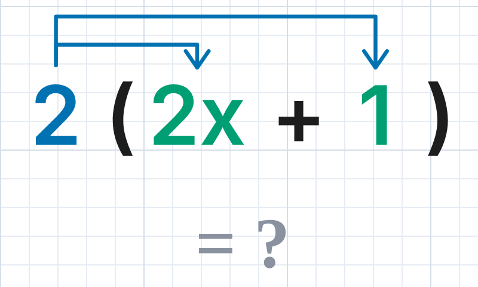
  - From **Build it, Groups of Terms**, first I'm stuck: blue arrows from the 2 to each term inside the brackets. The line reads "2 distributes to both terms: each arrow is a multiplication."
  - Not a Solve it picture.
- **First appears:** as a Solve it move, **designed only**. As a skill, **built** in Build it (Groups of Terms, Distribute then combine).

### 4.8 Combine like terms (`combine`)
- **Names:** code label and tooltip "Combine like terms" (`lightScreen.js:25`). The Build it card is called "Boxes & Circles: Combining like terms".
- **Icon:**  `icons/combine.png` (rebuilt, see §7), `icons/combine.svg`. Source: `lightScreen.js:57`. It reads `2x + 3x = 5x`, with the 5x in blue.
- **Lights:** Each side simplified (`DECISION-LOG.md`; code layout).
- **Goal candidates:** **Each side simplified** · Combine like terms · Fewer terms.
  - **Use: Each side simplified.** It is shared with Distribute (the decision log treats them as one cycle).
- **Worked example** (the icon's own example; ✓ checked at x = 1: 5 = 5, and x = 2: 10 = 10):
  1. `2x + 3x`
  2. Box the x terms, count the boxes
  3. `= 5x`
- **Picture:** 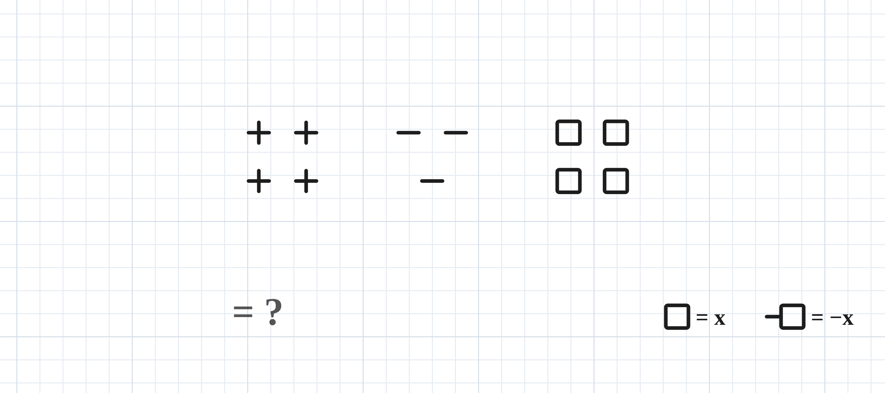
  - From **Build it, Boxes & Circles Level 2** ("read the model"): columns of + counters, − counters and boxes, with the key "□ = x" and "−□ = −x".
  - Not a Solve it picture.
- **First appears:** as a Solve it move, **designed only**. As a skill, **built** in Build it (Boxes & Circles).

## 5. The site's look

**Fonts** (loaded in `index.html:16`: Kalam 700; Lexend 400 and 600 only):

| Piece | Font (computed on the live screen) |
|---|---|
| Header title ("DIVIDE IT · Level 2") | Lexend 600, 18 px, upper case |
| The line (instructions) | Lexend 800, 24 px. **Only 400 and 600 are loaded, so the browser fakes the 800 bold.** |
| Equations (work stack) | **Kalam 700**, 36-56 px (handwritten look) |
| Buttons | Lexend 600, 17-18 px |
| Move buttons | Lexend 600, 13-14 px (icons only; the name pops up on hover) |
| Why? labels | Lexend 600, 13 px |
| Panel headings "MOVE", "WHY?" | Lexend 800, 18 px, grey `#7a818c` |
| "Solved for x" | Lexend 800, 16 px |

**Colours** (hex; from `style.css` and `lightScreen.js`):

| Use | Hex | Where |
|---|---|---|
| Ink (all text, outlines) | `#1d1d1d` | `--ink` |
| Page | `#ffffff`, with graph-paper lines `#e6ecf3` (minor) and `#d5dee9` (every fifth) | `--paper`, `--grid-minor`, `--grid-major` |
| **Operation blue** (fractions, the added amount, icon colour, hints) | `#0072b2` | written directly in the code; same as `--groups` |
| Light blue (the +n before it crosses, Cross icon) | `#6fb6e0` | `lightScreen.js:33` |
| Icon grey (the unchanging part of an icon) | `#8a8576` | `lightScreen.js:31` |
| Positive counter, Solve it scaffolds | ink `#1d1d1d` | Add seesaw, Switch sides |
| Positive counter, group diagram / Group It | green `#009e73` | `--inside` |
| Negative counter, Solve it scaffolds | ink `#1d1d1d`, in a **dashed** group box | Add seesaw |
| Negative counter, group diagram / Group It | magenta `#b8508f` | `--opposite` |
| Counter being moved (Switch sides) | magenta `#b5368c` on pink `#fbe3f1`, dashed | `style.css:2583` |
| x box | ink outline, 3.5 px, corner radius 6, no fill, with an "x" (Kalam 700) | Add seesaw `.vm-box` |
| Opposite box | ink box (radius 2) with a short dash in front: "−□" | Boxes & Circles key |
| Group box (counters) | white, ink 2.5 px, radius 12; blue `#0072b2` 4 px when pointed at | `style.css:2607, 2613` |
| Line box | yellow `#fff6b8`, 3 px ink border, radius 14; red `#fdebe8` / green `#e3f4ea` versions | `style.css:2768-2770` |
| Panel (Move / Why?) | `#fffdf2`, 3 px ink border, radius 16 | `style.css:2788` |
| Greyed move | `#dcdad2` fill, dashed `#6b685f` edge | computed |
| Selected move | `#fff6b8`, 3 px border | `style.css:2792` |
| Step highlight in a check | purple `#7b3fb0`, bold | `--accent` |
| Balanced / Not balanced text | `#1b6e3a` / `#a3281b` | |
| Section pastels (home) | Count it `#cfe3f8`, Build it `#cfebd3`, Solve it `#f9d3cd` | `style.css:2428-2430` |

**Why? light states** (`style.css:2680-2684`). Each is a square box, radius 6 (22 px with a 2 px border in the panel), and each state has a mark as well as a colour:
- **Off** (not judged yet): white box, **dashed** grey `#9a9a9a` edge, no mark; the label is grey `#9a9a9a`.
- **Partly / no change:** grey `#ececec` box with **–**.
- **On (met):** green `#3aa76d` box, `#1b6e3a` edge, white **✓**.
- **Worse:** red `#d9534f` box, `#a3281b` edge, white **✗**.

**Colours already tied to a move:** blue `#0072b2` marks whatever the move adds or changes, in every icon and in the work stack ("the operation is blue wherever it appears", loop §3D). No move has its own colour.

**Shapes:**
- Buttons: radius 10, 2 px ink border, white.
- Counters: plain + and − marks, 3.5 px round-capped strokes, with no circle around them.

**The four pieces** (3× scale, white background):

| Positive counter | Negative counter | x box | Opposite box |
|---|---|---|---|
|  | 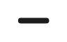 | 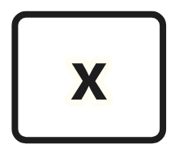 | 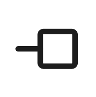 |
| **Use** (Add seesaw, ink) | **Use** (Add seesaw, ink) | Add seesaw (has an x inside: **don't use**) | **Use** (Boxes & Circles key) |
|  | 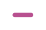 | 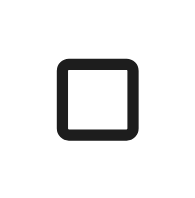 | 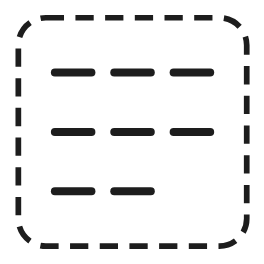 |
| Group diagram (green: don't use) | Group diagram (magenta: don't use) | **Use** (Boxes & Circles, empty) | A negative group (dashed), Add seesaw |

**How "Solved for x" is drawn:** 
- It is the last row of the Move / Why? panel, under a dashed grey rule.
- The words "Solved for x" are on the left (Lexend 800, ink) and one light box is on the right.
- It turns green ✓ when x is alone on its side.

## 6. The big goal: every place the app states it

| Where | Exact wording | Source |
|---|---|---|
| The choice prompt (every state) | "Would you like to guess the solution **(the value of x)**, or use a move to make the problem simpler?" | `solveLoop.js:34` |
| The uber-goal light | "**Solved for x**" | `lightScreen.js:294`; loop §5 |
| When x is alone | "x is alone. **What is it?** Type it." | `addBothFeedback.js:91` |
| I'm stuck at x alone (Add) | "x is alone. **Work out what x is** and type it." | `addBothFeedback.js:99` |
| Level 1 walkthroughs (both cards) | "We don't know x yet, but the = sign tells us both sides are balanced." | `numericFeedback.js:20`, `divideNumericFeedback.js:17` |
| Level 1 walkthroughs, the end | "2 is **the amount that makes it balance**." | `numericFeedback.js:25`, `divideNumericFeedback.js:22` |
| A correct answer | "Yes! x = 15, **and it balances**." | `addBothFeedback.js:107` |
| A correct answer (old cards) | "Yes! x = …, and it balances: both sides are the same." | `solveFeedback.js:35` |
| The old intro | "Choose a move. **To get x alone**, cancel the number next to it." | `addBothFeedback.js:55` |
| Divide it, I'm stuck guided | "Count it, and **type what x is**." | `divideFeedback.js:43` |

- **"Find the value of x":** not found anywhere in the app. The closest is "the value of x" in the choice prompt.
- **"What x has to be":** not found.
- **"Value of 1x":** not found. The app says "one box" (Divide it) and "x alone".

## 7. Problems and questions

1. **Decided (Karl, 2026-10-13): the two-boxes icon's poster is titled "Trade places"**, the app's own name. "Switch sides" stays retired; in the app and the printed notes it was the old name for Cross the border. (Swapping the sides is the *symmetric* property of equality, if a label is wanted: a = b means b = a.)
2. **Still open: "Flip it" clash:** the designed Solve it card "Flip it" (move: Flip everything) and Count it's existing card "Flip It" (subtracting integers).
3. **Decided: draw it "−□".** The opposite box was drawn two ways:
   - The only opposite box the app draws is "−□", a box with a dash in front (Boxes & Circles key).
   - `SPEC-FLIP-IT.md` §1 says "An opposite box is drawn as an opposite box, never as 'a box with a minus'".
   - Decide which the poster uses.
4. **Decided for the posters: black counters.** In the app, counters are drawn two ways:
   - Solve it scaffolds (Add's seesaw, Switch sides) draw ink-black + and − marks, with negative groups in dashed boxes.
   - The group diagram (Divide it) and Group It draw green + and magenta −.
5. **Decided for the posters: the x box is empty.** In the app it is drawn two ways: with an "x" inside it in Solve it, and empty in Boxes & Circles.
6. **Five icons are rebuilt, not live.**
   - Cross, Multiply, Flip, Distribute and Combine are never live on a built card. Their `icons/<id>.png` is the real button with its greyed style removed in the browser (no code changed).
   - Their as-shown greyed state is `icons/<id>-as-shown-on-add.png`.
   - Add, Take a fraction and Trade places are screenshots of live buttons.
7. **Light pairings not settled:** No fractions (Take a fraction or the future Fraction equations card); all of Multiply's lights (code layout only); Each side simplified is shared by two moves.
8. **Decided: use Count it / Build it references** (§4). Flip everything and Multiply now have one; **Trade places has none** (question above). Originally: no picture for Multiply, Flip everything or Trade places. Distribute's and Combine's pictures come from Build it cards.
9. **Multiply has no example in move form.** The one shown is constructed; it is not from the code.
10. **Cross the border** is greyed on every built card. The only built version is the retired Switch sides card.
11. **Decided: use real Lexend 700/800 for print.** Fonts: Lexend 800 is used but only 400 and 600 are loaded, so heavy weights are synthesised. For print, use real Lexend 700 or 800.

## Files

- **`icons/<move-id>.png`:** the eight move icons, active state, 3×.
- **`icons/<move-id>.svg`:** the icon SVG source (it uses Lexend; the arrowhead marker is inside).
- **`icons/<move-id>-as-shown-on-add.png`:** each button as it looks on the Add card.
- **`icons/pieces/`:** the pieces and the Solved for x row.
- **`icons/pictures/`:** the scaffold and Build it pictures.
